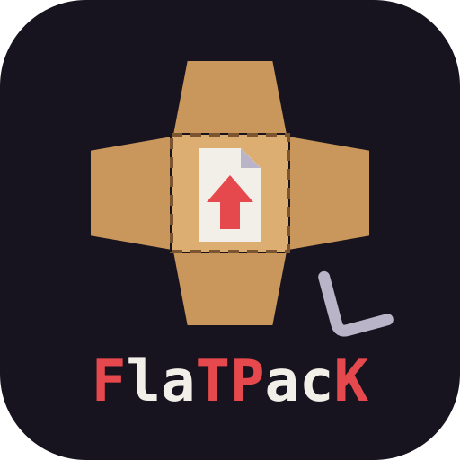

# FlaTPacK

[](https://github.com/martin-cowie/flatpack/actions/workflows/ci.yml)
[](https://github.com/martin-cowie/flatpack/releases/latest)
[](LICENSE)


An in-memory FTP server built with [libunftp](https://github.com/bolcom/libunftp), which forwards
uploaded files to [Apache Kafka](https://kafka.apache.org/) on request.

## Yes, but .. *why*?

I have been asked for this exact integration more than a few times, and thankfully each time my suggested alternative, the excellent [kcat](https://github.com/edenhill/kcat), was adopted instead. But the awful idea stuck with me: surely the unholy union of Kafka and FTP should be possible? IBM's [VAN FTP adapter](https://www.ibm.com/docs/en/ste/8.4.1?topic=overview-van-access-through-ftp-adapter) does something similar, after all. 

So I built it. 

In the unlikely case that you find this useful then give this repo a star. 

## Features

- FTP authentication is handled by the Kafka cluster: the FTP username and password are the user's Kafka credentials
- Each FTP Session gets its own isolated in-memory storage, reset when the Session ends
- Supports upload (`STOR`), download (`RETR`), delete (`DELE`), and rename (`RNFR`/`RNTO`)
- Files live in a single flat namespace — subdirectories (`MKD`/`RMD`) are not supported
- Custom `SITE SEND` command publishes one or more uploaded files to a Kafka topic. Run `SITE SEND -h` for options
- Custom `SITE TOPIC` command reports or sets the Session topic used by `SITE SEND`. Run `SITE TOPIC -h` for options
- Custom `SITE TOPICS` command lists the topics on the cluster. Run `SITE TOPICS -h` for options

## Configuration

Kafka settings are defined in `config.toml`. Copy the example to get started:

```sh
cp config.toml.example config.toml
```

```toml
[kafka]
brokers = "localhost:9092,otherhost:9092"
default_topic = "rust-topic"
message_timeout_ms = 5000
```

Edit `config.toml` to set your own Kafka settings. The `[kafka]` table is
required:

| Field | Required | Meaning |
|---|---|---|
| `brokers` | Yes | Comma-separated `host:port` list; the server needs only one to be reachable |
| `default_topic` | Yes | Topic a Session starts with; `SITE SEND` uses it until `SITE TOPIC` changes it |
| `message_timeout_ms` | No (default `5000`) | How long to wait for a message's delivery, and for `SITE TOPICS` and `SITE TOPIC` to hear from the cluster |
| `auth_timeout_ms` | No (default `5000`) | How long a login waits for Kafka to accept or reject the credentials |
| `security_protocol` | No (default `PLAINTEXT`) | `PLAINTEXT` or `SASL_PLAINTEXT` |
| `sasl_mechanism` | When `security_protocol` is `SASL_PLAINTEXT` | `PLAIN`, `SCRAM-SHA-256` or `SCRAM-SHA-512` |

An optional `[server]` table holds settings for the server itself:

| Field | Required | Meaning |
|---|---|---|
| `port` | No (default `2121`) | TCP port the FTP server listens on |
| `log_level` | No (default `info`) | Least severe messages logged: `trace`, `debug`, `info`, `warn` or `error` |

The server won't start if `brokers` or `default_topic` is missing, if `sasl_mechanism` is missing under
`SASL_PLAINTEXT`, or if `security_protocol` or `sasl_mechanism` has an unsupported value.

## Authentication

The server keeps no user accounts. A login succeeds only if the Kafka cluster accepts the username and
password the FTP client supplies, and the Session then publishes to Kafka as that user.

- **`PLAINTEXT`**: the cluster has no authentication, so any username and password is accepted as long
  as the broker is reachable. The server logs a warning at startup.
- **`SASL_PLAINTEXT`**: the credentials are sent to Kafka using the configured mechanism. Prefer
  `SCRAM-SHA-256` or `SCRAM-SHA-512`, which never send the password to Kafka; `PLAIN` does.

Traffic is not encrypted: FTP passwords cross the network in clear text, and
Kafka messages are unencrypted. Every login costs a round trip to the broker, and no
logins succeed while the broker is unreachable.

## Building

You need [Rust](https://rustup.rs/) (CI uses 1.100.0), and a few native tools and libraries, because
librdkafka is compiled from source and linked against the system's OpenSSL.

On Debian or Ubuntu:

```sh
sudo apt-get install g++ make pkg-config libssl-dev
```

On macOS, with [Homebrew](https://brew.sh/):

```sh
xcode-select --install
brew install openssl pkg-config
```

Then:

```sh
cargo build --release
```

The binary is written to `target/release/flatpack`.

## Running

```sh
cargo run
```

The server listens on `0.0.0.0:2121`, or on the `[server] port` from `config.toml`. Passive mode ports are `50000–65535`.

The server reads `config.toml` from the current directory. Use `--config <path>` (or `-c`) to read a different file.

## Usage

Connect with any FTP client. Example using `lftp`:

```sh
lftp -u alice,password123 ftp://127.0.0.1:2121
```

### Supported commands

| Command | Description |
|---|---|
| `STOR <file>` | Upload a file |
| `RETR <file>` | Download a file |
| `DELE <file>` | Delete a file |
| `RNFR`/`RNTO` | Rename a file |
| `SITE SEND [-t\|--topic <topic>] [--key <key>] [--header <name>=<value>]... <file>...` | Publish one or more uploaded files to Kafka |
| `SITE TOPICS [<glob>]` | List the topics on the Kafka cluster, one per line |
| `SITE TOPIC [-c] [<topic>]` | Report the Session topic, set it, or with `-c` create the topic and set it |

`SITE SEND` publishes each named file as a separate Kafka message, and replies with each delivery's partition, offset and timestamp.
Each message's key is the originating file name. Use `--key <key>` to override that.
The destination Kafka topic is, in order of precedence:
1. The value of the `--topic` switch
2. The Session topic
3. `config.toml`'s `[kafka] default_topic`

`--header` adds a Kafka message header and may be repeated; every message in the command gets the
same headers, in the order given. The value is everything after the first `=`, so it may itself
contain `=`. Quote an argument that contains spaces:

```
SITE SEND --header content-type=application/json --header "source=ftp gateway" a.json b.json
```

`SITE TOPICS` lists the cluster's topics, sorted, queried with the Session's Kafka credentials. An
optional glob narrows the list: `*` matches any run of characters and `?` matches one, and the whole
name must match (`SITE TOPICS 'orders-*'`). Internal topics, whose names start with `_`, are hidden
unless the glob itself starts with `_`. The reply opens with `all topics` or `topics matching <glob>`
and closes with `listed <n> topics`, with the count written with thousands separators.

`SITE TOPIC` reports the Session topic, which starts as `default_topic`. `SITE TOPIC <topic>` sets it
for the rest of the Session, and is refused with `550` if the topic does not exist on the cluster.
`SITE TOPIC -c <topic>` creates the topic with the broker's default partitions and replication, then
sets it; a name Kafka would reject gets `501`, and an existing topic or a refusal by the broker gets
`550`. Creating a topic needs the Session's credentials to be allowed to, and keeps the login's
Kafka credentials in memory for the Session (see ADR 0002).

### Example session

Using [lftp](https://lftp.yar.ru/), whose `site` command passes `SITE SEND` to the server:

```console
$ lftp -u alice,password123 -p 2121 localhost
lftp alice@localhost:~> put hello.txt
13 bytes transferred
lftp alice@localhost:/> ls
-rwxr-xr-x            1            0            0             13 Nov 25 15:38 hello.txt
lftp alice@localhost:/> site SEND hello.txt
200 Sent file "hello.txt" as message to rust-topic. Delivery { partition: 0, offset: 5, timestamp: CreateTime(1795621087855) }
lftp alice@localhost:/> mv hello.txt world.txt
rename successful
lftp alice@localhost:/> get world.txt
13 bytes transferred
lftp alice@localhost:/> rm world.txt
rm ok, `world.txt' removed
lftp alice@localhost:/> bye
```

## Testing

```sh
cargo test
```

Runs the unit tests (in `src/`) and a black-box integration suite (`tests/ftp_integration.rs`) that
spawns the real `flatpack` binary and drives it as an FTP client would, over TCP. It also runs
`tests/kafka_mock_integration.rs`, which runs the server against librdkafka's in-process mock Kafka
cluster, checking that `SITE SEND` delivers payload, key and headers, and that `SITE TOPICS` and
`SITE TOPIC` list the topics and set the Session topic. None of these needs any external services.

Further end-to-end tests, `tests/kafka_integration.rs` and `tests/kafka_sasl_integration.rs`, run
against a real Kafka broker started via [testcontainers](https://testcontainers.com/). They require a
working Docker daemon, so they're excluded from the default run:

```sh
cargo test --test kafka_integration --test kafka_sasl_integration -- --ignored
```

To check coverage (via [cargo-llvm-cov](https://github.com/taiki-e/cargo-llvm-cov)):

```sh
cargo llvm-cov --show-missing-lines
```

`cargo coverage`, an alias in `.cargo/config.toml`, fails if line coverage drops below the threshold set in that alias. CI runs it in place of a plain `cargo test`.
The Docker-based `#[ignore]` tests are not run in CI, so they stay a local, manual check.

## Pre-push checks

Once per clone, enable the pre-push hook, which runs the same `cargo fmt --check` and
`cargo clippy --all-targets -- -D warnings` as CI:

```sh
git config core.hooksPath .githooks
```

## Acknowledgements

Flatpack stands on the work of the [unFTP](https://unftp.rs/) project. The FTP protocol is handled by its
[libunftp](https://github.com/bolcom/libunftp) library and the companion
[unftp-core](https://github.com/bolcom/libunftp/tree/master/crates/unftp-core) crate, both licensed
under Apache-2.0. My profound thanks to their maintainers and contributors.

## Hire me

I wrote flatpack, and I am open to permanent or contract roles. If you need help with Rust, Java, TypeScript or Kafka, please [get in touch](https://www.linkedin.com/in/martin-cowie-7015731/).